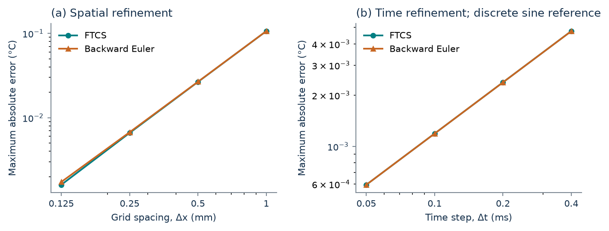
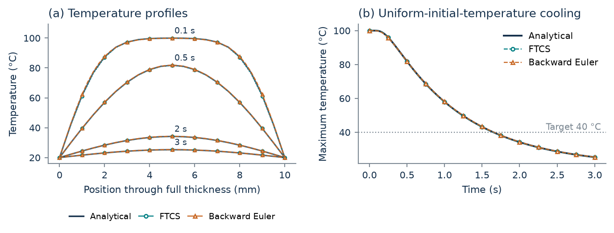
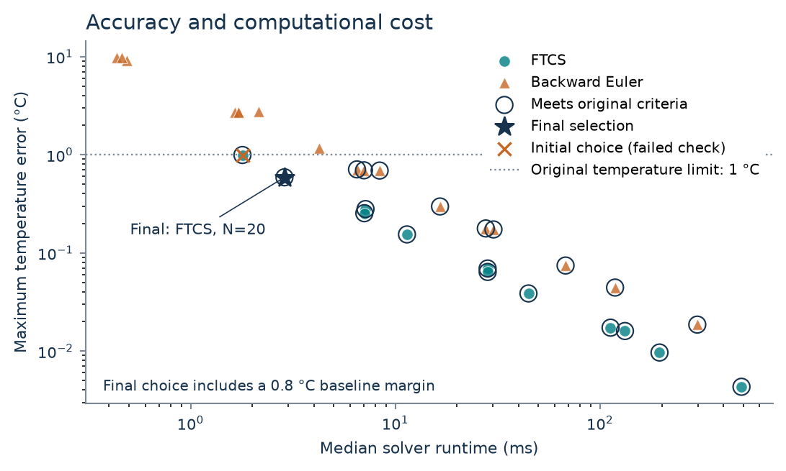
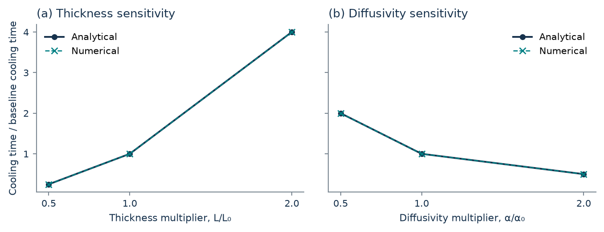
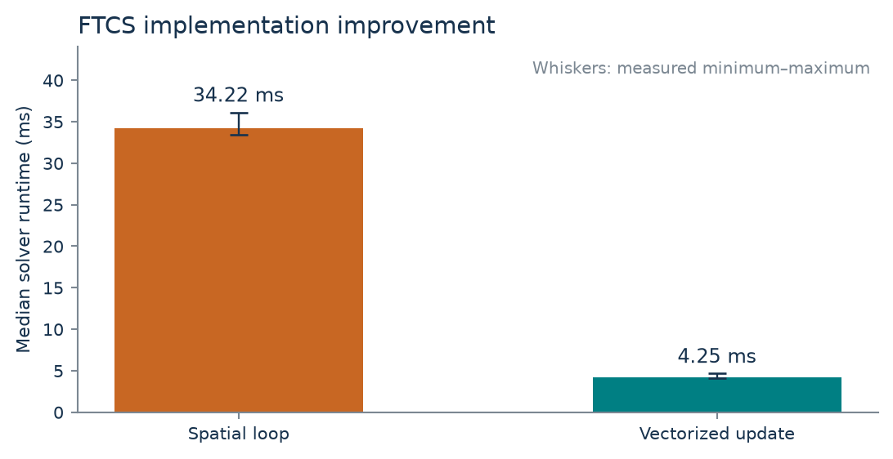

# Accuracy, stability and computational cost of plate-cooling solvers

MMA3001 Numerical Methods and Machine Learning | Technical report | 24 October 2026

## 1. Engineering question and scope

**Abstract.** This study predicts when the hottest point of an idealised plate reaches a specified temperature. Explicit FTCS and implicit backward Euler are verified against analytical solutions and compared under common accuracy requirements. The final FTCS configuration uses 20 intervals and a 0.00625 s time step. Its baseline cooling-time estimate is 1.645588 s, with 0.229% error against the analytical value, and its maximum benchmark temperature error is 0.589 C. An initially faster configuration failed a larger-temperature-span check; that failure prompted an openly recorded accuracy-margin revision.

Conduction times influence thermal-process scheduling and preliminary component cooling estimates. The intended decision is which solver and resolution provide adequate numerical accuracy at low computational cost. The model represents a homogeneous slab with lateral dimensions sufficiently large to neglect lateral gradients, constant properties and both faces held at the same fixed temperature. It excludes convection, radiation, contact resistance, internal generation and phase change. The threshold is an analysis target, rather than a certified handling temperature.

| Primary input | Baseline / final setting | Format, units and domain |
| --- | --- | --- |
| Full thickness L | 0.010 | Finite scalar, m; positive |
| Diffusivity alpha | 1e-5 | Finite scalar, m^2/s; positive |
| Initial / face / target T | 100 / 20 / 40 | Scalars, C; face < target < initial for cooling |
| Spatial intervals N | 80 / 20 | Integer >=4; even in this study |
| Time step dt | 0.0005 / 0.00625 | Finite positive scalar, s |
| Horizon | 3.0 | Finite positive scalar, s |
| Method / profile | FTCS / uniform | Enumerated method and initial profile |

Outputs are numerical arrays of positions (m), times (s), maximum and field temperatures (C), and a scalar interpolated crossing time (s) or an explicit missing result. Snapshot arrays have shape (snapshot time, position). JSON defines inputs, CSV records study evidence and NPZ stores single-case arrays. All parameters are synthetic illustrative inputs; no measured dataset or material-property identification is claimed.

<!-- PAGE BREAK -->

## 2. Mathematical model and implementation

The full thickness spans x=0 to x=L. Thermal diffusivity relates to conductivity, density and specific heat through alpha=k/(rho*c_p). The governing problem is:

`dT/dt = alpha*d2T/dx2; T(0,t)=T(L,t)=Tb.`

The cooling initial condition is Ti in the interior, with the face values imposed immediately. This deliberate initial/boundary discontinuity creates steep early gradients. Positive-time verification and a separate smooth benchmark avoid interpreting the initial jump as numerical failure. A comparable slab example discusses this discontinuity [5].

Let dx=L/N and r=alpha*dt/dx^2. Applying a central second difference gives:

`FTCS: Ti_new = Ti_old + r*(Tleft_old - 2*Ti_old + Tright_old).`

`Backward Euler: -r*Tleft_new + (1+2*r)*Ti_new - r*Tright_new = Ti_old.`

These equations are derived for this implementation; standard finite-difference methodology provides context [3]. FTCS uses the previous field simultaneously. Backward Euler forms a tridiagonal system; known face values contribute r*Tb to the first and last interior right-hand-side entries. SciPy's banded solve stores three diagonals [4]. The coefficient matrix can be reused when r is unchanged; factorisation is not cached.

For a sine initial excess A*sin(pi*x/L), separation of variables gives:

`T = Tb + A*sin(pi*x/L)*exp[-alpha*(pi/L)^2*t].`

For uniform initial excess, the analytical reference is:

`T = Tb + (Ti-Tb)*(4/pi)*sum[sin(n*pi*x/L)/n * exp(-alpha*(n*pi/L)^2*t)]`

where n=1,3,5,... . The reference implementation bounds the omitted series tail and increases its term count when necessary.

FTCS requires r<=0.5 for this standard diffusion discretisation. Backward Euler is stable for positive time steps, but stability alone does not ensure accuracy. Both schemes have first-order temporal and second-order spatial truncation behaviour for smooth solutions. Actual steps are shortened to hit requested snapshots and the endpoint exactly, using the shortened duration consistently. Unsupported options and invalid scalar inputs raise clear errors; normal FTCS rejects unstable settings.

<!-- PAGE BREAK -->

## 3. Verification, metrics and decision protocol

Analytical agreement verifies implementation of the stated mathematical model. It does not establish agreement with real cooling hardware, which would require relevant experimental measurements. This distinction follows the intended-use approach to simulation credibility [6].

Temperature comparisons use identical positions and times. RMSE is sqrt(mean((Tnumerical-Treference)^2)); maximum error is max(abs(Tnumerical-Treference)). Both have units C. Cooling-time error is the absolute crossing-time difference divided by the analytical crossing time. Numerical crossings are linearly interpolated between adjacent maximum-temperature samples; an unreached target returns an explicit missing result.

| Original numerical acceptance condition | Evaluation |
| --- | --- |
| Maximum temperature error <=1 C | All nodes at 0.1, 0.5, 1, 2 and 3 s |
| Cooling-time error <=2% | Independently rooted analytical centre temperature |
| Further-refinement crossing change <1% | Double N and divide dt by four |
| Physical checks | Face values, sampled lower bounds, all-step maximum bounds and monotonicity |

These are declared preliminary-study tolerances, rather than course-prescribed or industrial standards. The candidate sweep contains 29 unique settings: N=20,40,80,160, with several explicit and implicit diffusion numbers. The absolute targets were fixed before evaluation; the subsequent tighter development margin is disclosed on page 6.

The uniform reference's 20- and 40-starting-term evaluations agree to displayed floating-point precision at all benchmark times. An analytic tail bound targets 1e-11 C. A bracketed root gives 1.649365094916235 s; an independently written centre-series bisection gives 1.649365094916234 s.

The final automated report records **64 passing tests**. Checks include a hand-solved three-unknown implicit system and residual, sine decay, both refinement behaviours, equilibrium, symmetry, bounds, exact event times, old-state FTCS updates, invalid inputs and loop equivalence. These checks support correctness within their tested cases; they do not prove every possible input safe or physically realistic.

<!-- PAGE BREAK -->

## 4. Smooth-solution verification and convergence

The smooth benchmark uses A=80 C, N=80 and dt=0.0005 s. Maximum errors are small for both implementations:

| Time, s | FTCS maximum error, C | Backward Euler maximum error, C |
| --- | --- | --- |
| 0.1 | 0.000846 | 0.002683 |
| 0.5 | 0.002850 | 0.009041 |
| 1.0 | 0.003480 | 0.011040 |

The spatial sweep N=10,20,40,80 gives final observed orders 2.042 for FTCS and 1.959 for backward Euler. At N=80, errors are 0.001602 and 0.001730 C respectively. Halving the time step changes each field by approximately 0.000032 C, showing that the remaining spatial comparison is predominantly controlled by grid error.

For temporal refinement, dt decreases from 0.0004 to 0.00005 s on N=80. The reference is the exact solution of the discrete spatial operator, whose sine-mode eigenvalue is -4*alpha*sin(pi/(2*N))^2/dx^2. This isolates integration error and avoids cancellation between FTCS temporal and spatial errors. Final observed time orders are 1.000039 and 0.999961. Therefore the measured results support the predicted first-order time and second-order space behaviour over the tested ranges. They do not imply the nonsmooth initial instant has the same observed convergence.

<!-- PAGE BREAK -->

## 5. Uniform cooling and the final numerical result

The engineering case starts with 100 C interior and 20 C faces. Its analytical hottest point is the centre; even N places a grid node there. The final selected FTCS estimate reaches 40 C at **1.645588 s**, 0.003777 s earlier than the analytical 1.649365 s. The horizon comfortably includes this crossing.

| Configuration | N / dt, s | Maximum error, C | Crossing, s | Crossing error |
| --- | --- | --- | --- | --- |
| Fine FTCS baseline | 80 / 0.0005 | 0.050294 | 1.649040 | 0.0197% |
| Final FTCS | 20 / 0.00625 | 0.588960 | 1.645588 | 0.2290% |
| Best qualifying backward Euler | 40 / 0.00625 | 0.709187 | 1.654775 | 0.3280% |

Errors aggregate the five declared positive benchmark times, rather than only the final field. Final FTCS RMSE is 0.157913 C; backward Euler RMSE is 0.165076 C. Further refinement changes the explicit crossing by 0.1718%, and the implicit crossing by 0.2458%, both below 1%.

The fine baseline is more accurate than needed for the declared decision. The final setting trades part of that accuracy for fewer steps while retaining margin to the accepted bounds. Neither the numerical threshold nor the prescribed face temperature establishes a real object's safe-handling time.

<!-- PAGE BREAK -->

## 6. Method selection, a failed check and revision

Of 29 candidates, 21 passed the original common criteria. The initially fastest was FTCS, N=20, dt=0.01 s: 1.791 ms median runtime and 0.993998 C maximum baseline error. It had only 0.006 C headroom. A larger initial-to-face span, 95 C instead of 80 C, increased error to 1.180372 C and failed the unchanged 1 C requirement.

That case became development evidence. A recorded revision added a **0.8 C development error ceiling**, preserving the original absolute acceptance limit. Linearity predicts that temperature error scales with the initial-to-face span under equivalent dimensionless settings; the tighter ceiling provides margin for the observed 95/80 factor. Twenty existing candidates meet this margin.

The revised FTCS choice takes 2.873 ms (range 2.871-2.876 ms), versus 6.494 ms for the best qualifying implicit method and 33.472 ms for the fine baseline: 2.26 and 11.65 times faster respectively.

| Check | Maximum error, C | Crossing error | Outcome |
| --- | --- | --- | --- |
| Initial larger-span confirmation | 1.180372 | 0.4184% | Failed; then development |
| Reused case, revised setting | 0.699390 | 0.2333% | Passed; development |
| Fresh final confirmation | 0.552150 | 0.2137% | Passed |

The final case uses L=0.018 m, alpha=1.3e-5 m^2/s and temperatures 90/15/30 C. Its predicted/reference crossings are 4.664226/4.674217 s. The revised choice was frozen before this check and not retuned afterward. Linear scaling makes some agreement predictable; this is a mathematical confirmation, not independent physical validation.

<!-- PAGE BREAK -->

## 7. Engineering sensitivity and instability

Keeping the temperature ratio fixed makes the cooling timescale proportional to L^2/alpha. Sensitivity runs preserve the dimensionless grid and time step, so changes represent the prescribed geometry/property effect rather than a change in numerical resolution.

| Thickness, m | Analytical crossing, s | Numerical crossing, s |
| --- | --- | --- |
| 0.005 | 0.412341 | 0.411397 |
| 0.010 | 1.649365 | 1.645588 |
| 0.020 | 6.597460 | 6.582353 |

Doubling full thickness quadruples the analytical cooling time; doubling diffusivity halves it to 0.824683 s. Relative numerical error remains 0.2290% throughout these self-similar cases. This is a useful consistency check, rather than experimental discovery of the scaling law. Actual cooling decisions would also depend on whether fixed face temperatures and constant diffusivity are credible.

The controlled stability experiment adds an alternating 1e-8 C perturbation to the smooth initial profile on N=40. After 120 steps, actual r=0.4 produces 0.012692 C maximum error, whereas r=0.6 produces approximately 3.10e9 C error. The latter is deliberately permitted only through a diagnostic override; finite erroneous values are not clipped. This shows why a visually smooth early result can conceal an unstable high-frequency mode. A non-finite result triggers a failure rather than a plausible cooling estimate. Backward Euler avoids this explicit restriction but still requires accuracy checks, as its coarse-step candidates demonstrate.

<!-- PAGE BREAK -->

## 8. Implementation performance and reproducibility

The implementation optimisation compares an explicit spatial loop with NumPy vectorisation at identical N=160, r=0.4 and 640 steps. Maximum output difference is zero in the saved comparison.

Loop and vectorised median runtimes are 34.225 and 4.250 ms: an 8.05-fold improvement. A representative loop profile records 0.034 s inside the solver out of 0.038 s total, supporting the choice to remove interpreted per-node work. This implementation comparison is distinct from changing the discretisation to meet the engineering tolerance.

Timings warm the solver, then repeat batches targeting 40 ms, capped at 20 solves. Candidate results use three batches and report median/minimum/maximum; some capped batches are shorter than the target. Timing excludes reference evaluation, plotting and file I/O. Timed runs retain the same scalar maximum history and omit field snapshots. Benchmark events align with the integration grid. Measurements are specific to macOS ARM64, Python 3.12.14, NumPy 2.3.5 and SciPy 1.18.1.

Both methods have O(N*M) arithmetic for N intervals and M steps. Working fields and banded coefficients use O(N), scalar histories O(M), and S snapshots O(S*N). Final retained arrays total 8,912 bytes versus 100,592 for the baseline. These are array-storage counts, excluding Python lists, temporary arrays and peak process memory.

The explicit stencil performs approximately five basic scalar floating-point operations per interior update: about 45,600 operations for the selected 19 interior points and 480 steps. This algebraic count excludes copies, diagnostics and history handling; profiling shows why identical stencil arithmetic can have very different Python runtimes.

JSON configurations, CSV evidence and generation scripts reproduce the results. Tests and generated HTML document the public API; the README provides setup and execution. Physical properties remain illustrative. Verification covers selected finite, representable inputs; finite scalar acceptance is not a claim that arbitrarily extreme scales are numerically practical or physically meaningful.

<!-- PAGE BREAK -->

## 9. Conclusions, limitations and AI reflection

For the stated fixed-face plate, vectorised FTCS with N=20 and r=0.25 is the fastest measured configuration meeting the revised development margin and the original numerical requirements. It estimates the baseline 40 C crossing within 0.229%, uses 480 steps, and is 11.65 times faster than the fine baseline on the measured machine. Backward Euler remains a credible stable alternative; its extra per-step work and coarse-step errors make it slower at the common accuracy requirements in this sweep. This conclusion is specific to the tested implementations, cases and hardware.

The failed initial confirmation is a central lesson: a configuration just inside an absolute error tolerance can fail when the thermal span increases. Stability, convergence, benchmark accuracy and physical validity answer different questions. Explicit margins and preserved failed evidence make the final decision more defensible than reporting only successful cases.

OpenAI Codex and collaborating AI agents generated most of the planning, code, tests, experiments, figures, documentation and report prose. The contribution is substantial to near-total artifact production; no precise percentage was measured. AI accelerated implementation and cross-checking. Checks included independent algebra, a separately written series/root calculation, automated tests, raw-table audits and visual review of figures and documents.

AI-generated work initially inserted default snapshots that silently subdivided intended time steps. Independent one-step and stability tests exposed this; defaults were corrected to preserve the requested schedule. The first numerical design also failed the larger-span check and was revised transparently. These are recorded limitations and corrections, not evidence that AI output can be accepted without checking.

The student remains responsible for submitted claims, technical decisions and independent explanation. This artifact cannot establish personal learning or interview readiness. Those require the student's own review, derivation, reproduction and truthful reflection; no personal learning experience is invented here. The brief permits disclosed AI assistance and requires independent responses during the interview [1].

Useful next work is experimental comparison with instrumented cooling data, replacing ideal fixed faces with a justified convection/contact model, and investigating temperature-dependent properties. These extensions should follow physical evidence and a defined intended use, rather than adding numerical complexity alone.

<!-- PAGE BREAK -->

## References and computational evidence

1. MMA3001 teaching team (2026). *MMA3001_2026_Project_Brief*. Requirements and deliverables, pp. 1-9; full rubric, pp. 10-15. Supplied course document.

2. MMA3001 teaching team (2026). *Workshop 11 slides*, pp. 29-40; *Workshop 12 slides*, pp. 7-16. Supplied course material on numerical methods and PDEs.

3. Persson, P.-O. *Finite Difference Methods for PDEs*, Math 228B, University of California, Berkeley. [Primary lecture notes](https://persson.berkeley.edu/math228b/html/finite_difference_methods_for_PDEs.html). Accessed 24 October 2026.

4. SciPy community. *scipy.linalg.solve_banded*. [Official API documentation](https://docs.scipy.org/doc/scipy/reference/generated/scipy.linalg.solve_banded.html). Accessed 24 October 2026. Installed version used: 1.18.1.

5. COMSOL. *Heat Conduction in a Finite Slab*, version 6.4. [Official analytical-comparison example](https://doc.comsol.com/6.4/doc/com.comsol.help.models.heat.heat_conduction_in_slab/heat_conduction_in_slab.html). Accessed 24 October 2026. Used as model context; the project does not use COMSOL output as its numerical reference.

6. NASA Kennedy Space Center. *Modeling and Simulations: FAQ*. [Verification, validation and intended-use guidance](https://public.ksc.nasa.gov/mns/faq/). Accessed 24 October 2026.

Computational evidence accompanies this report: `results/summary.json`, `results/tables/`, `configs/`, `reports/test_report.html`, `reports/profile.txt` and `notes/ai_use_log.md`. All numerical values above derive from the saved study outputs or the explicitly described independent mathematical check. Analytical expressions and finite-difference assembly are derived for this project; no experimental dataset or third-party simulation output is incorporated.
